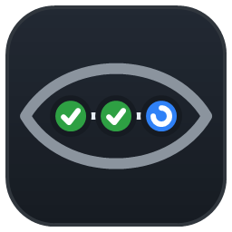

# Build Pulse

*One heartbeat for all your builds.*



A small tray app for Windows, macOS and Linux that watches selected Azure DevOps pipelines and GitHub Actions workflows, on one or more servers.

| Tray icon | Meaning |
|---|---|
| Green ✓ | Nothing running |
| Blue spinner | Building / deploying |
| **Flashing orange / red !** | A run is waiting for approval |
| Red ✕ | Can't reach the server |
| Small red dot | The latest finished run of a tracked pipeline failed |

- **Approvals** pop up in the bottom-right corner and stay until you **Approve**, **Reject** (asks you to confirm), **Open** it in the browser, or **Later** (snoozes it for 15 minutes; the icon keeps flashing).
- **Other status changes** (started, stage changed, succeeded, failed, ...) show as toasts that fade after about 6 seconds. You can mute them from the tray menu.
- **Left-click** the icon to open the dashboard: pending approvals plus the last 8 builds. Click a row to open it in the browser. Click a panel's header to collapse it to one status icon per pipeline (hover an icon for details, click it to open the run); collapsed panels stay collapsed across restarts.
- **Right-click** the icon for Refresh, Settings, Mute, Start with Windows, and Exit.

## Install & updates

Download `BuildPulse.exe` from the [latest release](https://github.com/ravndal/build-pulse/releases/latest) and run it from a folder you can write to (for example `%LOCALAPPDATA%\BuildPulse`). On macOS and Linux, download `BuildPulse-<runtime>` (for example `BuildPulse-osx-arm64`).

Build Pulse used to be called DevOps Watcher. Updating an old install keeps its `DevOpsWatcher.exe` file name, and the first start moves its settings, log and start-at-login entry to the new names. Releases still ship `DevOpsWatcher*` copies of each executable so older versions can find the update.

The app never updates itself on its own. The dashboard footer (and the tray menu) has a **Check for updates** button; the app also looks quietly 30 seconds after start and then every 6 hours. When a newer release is found the button changes to **Update to vX.Y.Z**, and only clicking it downloads the new exe, checks its SHA-256 against the release, and restarts into it.

### Releasing

CI builds every push to `main` and every pull request. To ship a version, push a tag:

```bash
git tag v1.2.0 && git push origin v1.2.0
```

The Release workflow publishes the single-file exe with that version and creates the GitHub release; installed apps pick it up on their next check.

## Build & run

Requires the .NET 10 SDK.

```bash
dotnet build src/BuildPulse.Avalonia -c Release
```

```bash
src/BuildPulse.Avalonia/bin/Release/net10.0/BuildPulse.exe
```

To get a single self-contained exe:

```bash
dotnet publish src/BuildPulse.Avalonia -c Release -r win-x64 --self-contained -p:PublishSingleFile=true -p:IncludeNativeLibrariesForSelfExtract=true -o publish
```

Use another runtime (`osx-arm64`, `osx-x64`, `linux-x64`) for macOS or Linux.

### Repository layout

| Folder | Contents |
|---|---|
| `src/Shared/Models` | Settings and pipeline/run data types |
| `src/Shared/Sources` | Azure DevOps and GitHub API clients, demo source, rate limiter |
| `src/Shared/Services` | Polling, self-update, run at startup, secret storage |
| `src/Shared/Infrastructure` | JSON, logging and formatting helpers |
| `src/BuildPulse.Avalonia` | The tray app (Avalonia UI) |
| `src/tools` | `make-icon.cs`, which regenerates `assets/app.ico` and `assets/app.png` |

Run with `--demo` to try the UI with fake pipelines and no server. A deployment asks for approval about 45 seconds after start.

## Setup

On first run Settings opens with **Add server**. Add as many servers as you like; Settings lists them with Add / Edit / Remove. Adding a server starts by picking what to connect to, then asks only for what that target needs:

| Target | You enter |
|---|---|
| Azure DevOps | Organization name (and optionally one project to list) + PAT |
| Azure DevOps Server | Collection URL (`https://tfs.company.com/tfs/DefaultCollection`) + PAT or Windows sign-in |
| GitHub | Token |
| GitHub Enterprise | Server URL (`https://github.company.com` or `https://company.ghe.com`) + token |

**Azure DevOps**

1. Use a **PAT** with these scopes: *Build (Read & execute)* and *Project and Team (Read)*. Azure DevOps Server can use Windows authentication instead.
2. Click **Connect**, expand projects, and tick the pipelines you want to track.

**GitHub Actions**

1. Use a fine-grained token with repository permissions *Actions (Read)* and *Deployments (Read & write)*, or a classic token with the `repo` scope. Approving needs the write permission and that you're a required reviewer on the environment.
2. Click **Connect**, expand repositories, and tick the workflows you want to track.

Settings are saved in `%APPDATA%\BuildPulse\settings.json`. Tokens are encrypted with Windows DPAPI for your user. Settings from older versions (one Azure DevOps server) are moved into the server list on first start.

## Notes

- **GitHub Actions:** runs map to builds and jobs show as the stage dots. Environment reviews (*required reviewers*) are the approvals; you can approve or reject them from the popup when you're a reviewer. Environments with only a wait timer aren't shown as approvals. Unchanged responses are served from GitHub's ETag cache and don't count against the 5,000 requests/hour limit.

- Approvals use the YAML pipeline approvals API (environment approvals and checks). Classic Release pipelines are not covered.
- `ManualValidation` steps (agentless jobs) are detected from the build timeline and pop up like approvals. By default you resume or reject them in the browser (Open → Review).
- **Experimental:** Settings has an option to Resume/Reject Manual validation steps from the popup. Microsoft documents no API for this, so the app posts the documented `TaskCompleted` plan event for the waiting task and then re-reads the timeline to confirm the step moved on. It's unverified against real runs, and it's unknown whether Azure DevOps enforces the step's approver list for this call. Test it first with `test-pipelines/manual-validation-test.yml` in a sandbox project.
- **Rate limiting** is set in Settings → Rate limits (stored in `settings.json` under `RateLimits`). `PerUser` is one budget for the signed-in user (server + token, or Windows account) across all calls; `PerEndpoint` adds budgets per endpoint: `projects`, `definitions`, `builds`, `timeline`, `approvals`, `approvalUpdate`, `planEvents`. A call that would exceed a budget waits for a free slot, up to `MaxWaitSeconds`, then fails with a rate-limit error. `Requests: 0` means unlimited; `Enabled: false` turns client limits off. A `Retry-After` from Azure DevOps always pauses that user's calls.

  ```json
  "RateLimits": {
    "Enabled": true,
    "PerUser": { "Requests": 120, "PerSeconds": 60 },
    "PerEndpoint": {
      "timeline": { "Requests": 60, "PerSeconds": 60 },
      "approvals": { "Requests": 10, "PerSeconds": 60 }
    },
    "MaxWaitSeconds": 30
  }
  ```
- Diagnostics are written to `%APPDATA%\BuildPulse\log.txt` (no secrets).
- To approve, you must be one of the run's approvers. If you're not, the error shows in the popup.
- If the token can't read approvals, the app still detects waiting runs from the build timeline. You then approve from the browser.
